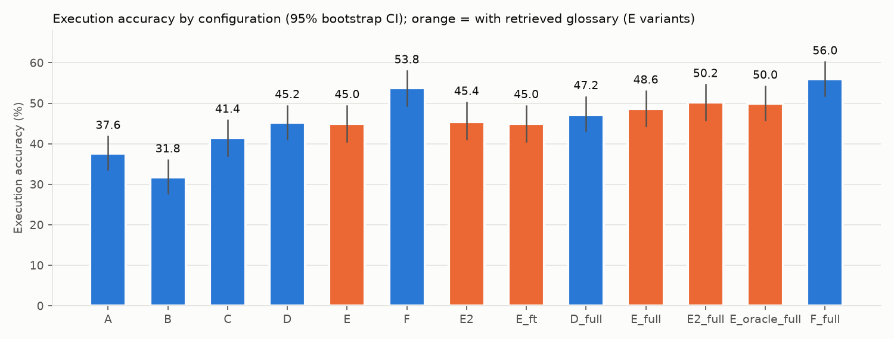
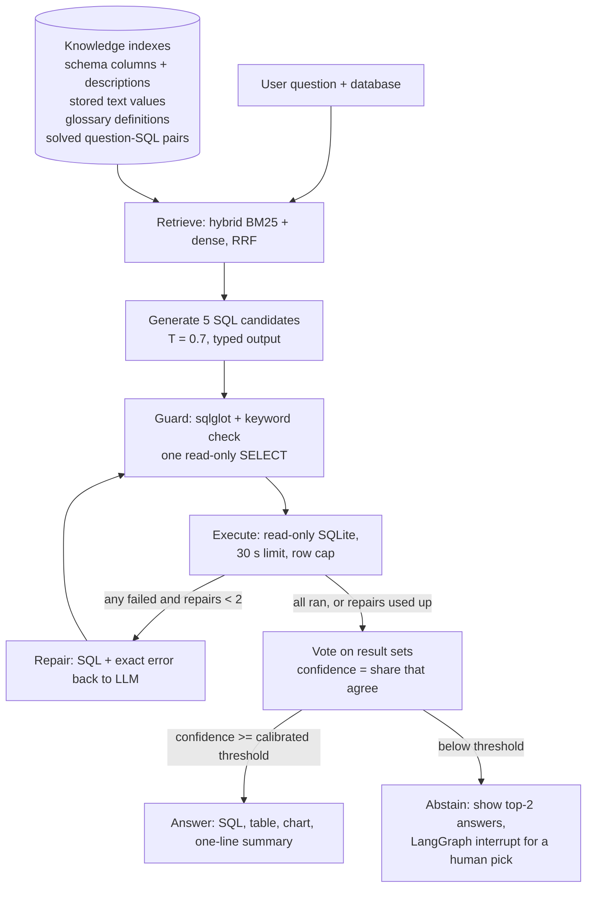
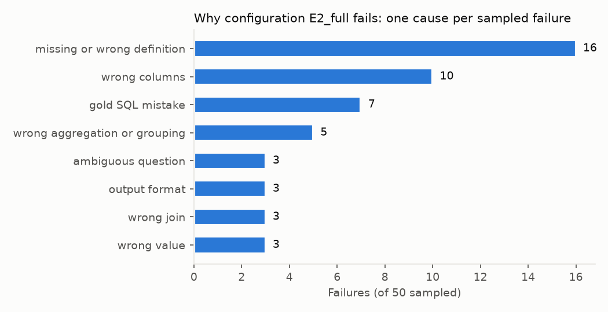
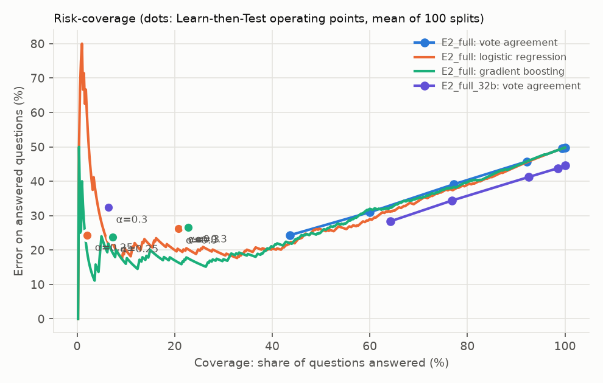

# GlossarySQL

**An agentic text-to-SQL analyst that looks up business definitions instead of being handed them.**

Ask a business question in plain English and GlossarySQL returns a verified SQLite query, the result
table, a chart and a one-line answer, or it declines when its candidate queries disagree. Text-to-SQL
benchmarks such as BIRD give the model an expert-written *hint* for every question ("eligible free
rate = `Free Meal Count` / `Enrollment`"). Real users never type that hint. GlossarySQL removes it and
retrieves definitions from a company glossary instead, then measures how much of the accuracy gap
that recovers.

Built with LangChain (models, prompts, typed outputs), LangGraph (the agent loop), FAISS + BM25
hybrid retrieval, vLLM-served open models (Qwen2.5-Coder 7B and 32B), sentence-transformers and
Gradio. Evaluated on all 500 questions of BIRD Mini-Dev (SQLite).

## Results at a glance

All numbers are execution accuracy (EX) on the 500 BIRD Mini-Dev questions, with 95% bootstrap
intervals. Each question is evaluated once, never seeing its own hint or SQL (two-fold split, below).

| System (Qwen2.5-Coder-7B) | EX % |
|---|---|
| A. Single query, full schema, no hints | 37.6 [33.6, 41.8] |
| D_full. + values, solved examples, repair loop, 5-way voting | 47.2 [43.2, 51.6] |
| **E2_full. D_full + retrieved glossary definitions (proposed)** | **50.2 [45.8, 54.6]** |
| F_full. D_full + the benchmark's perfect hints (upper bound) | 56.0 [51.8, 60.2] |

- **Retrieved definitions close 34% of the gap between no hints and perfect hints** (95% CI 3-66%;
  McNemar p = 0.049 for D_full vs E2_full). This is a modest, borderline-significant effect, and it
  depends on the setup (see RQ1).
- **The glossary, not the retriever, is the bottleneck.** An *oracle* retriever over the same glossary
  scores 50.0%, no better than the real one (50.2%). The remaining gap is definitions nobody wrote
  down: only 30% of questions have all of their definitions somewhere in the glossary. The largest
  error class among 50 labelled failures is a missing or wrong definition (16/50).
- **The agent loop matters**: repair + voting adds 3.8 points over single-shot (C 41.4 → D 45.2,
  p = 0.013). Top-15 schema retrieval, by contrast, *cost* 5.8 points against the full schema
  (A 37.6 → B 31.8, p = 0.006), because it drops needed columns.
- **Calibrated abstention works as a guarantee, but this model is too weak for strict targets.**
  With Learn-then-Test at α = 0.3, δ = 0.1, the agent answers ~21% of questions at ~73% accuracy, and
  accuracy fell below target in at most 10% of 100 random calibration splits, as promised. Targets of
  80-90% accuracy cannot be certified: even unanimous 5/5 answers are right only 75.7% of the time.
- **Extensions**: a contrastively fine-tuned schema retriever raises column recall@15 from 66.6% to
  73.1% on unseen databases (no EX change), and a learned confidence model improves AUROC from 0.78
  to 0.82 over raw vote agreement.



## How it works



- **Knowledge layer** (`src/glossarysql/ingest`, `retrieval`): four indexes per database. *Schema*
  has one document per column (name, type, description and coded values from BIRD's description
  CSVs, three sample values). *Values* holds the distinct short text values, fuzzy-matched to
  question phrases with `rapidfuzz`. *Glossary* holds the hints of the knowledge split, split into
  single definitions, de-duplicated, each pointing back to its source questions. *Examples* holds the
  solved question-SQL pairs of the knowledge split. Every index is BM25 + `bge-small-en-v1.5`
  dense retrieval fused with reciprocal rank fusion.
- **Agent** (`src/glossarysql/agent/graph.py`): a LangGraph `StateGraph` with the nodes above. Every
  experiment is the same graph; a YAML config switches parts on and off (`configs/`).
- **Safety**: two independent layers. The guard rejects anything except a single `SELECT`/`WITH`,
  and the connection is opened `mode=ro&immutable=1` with `PRAGMA query_only`, a progress-handler
  timeout and a row cap. Unit tests check that writes fail even if the guard is bypassed.
- **Calibration** (`src/glossarysql/calibration/ltt.py`): Learn-then-Test with exact binomial
  p-values and fixed-sequence testing over a grid fixed in advance.

## Experimental setup

- **Data**: BIRD Mini-Dev, SQLite version: 500 questions over 11 databases (148 simple, 250 moderate,
  102 challenging). All 500 gold queries execute and score 100% against themselves.
- **Split**: each database's questions are halved, stratified by difficulty (seed 42,
  `data/split.json`). Fold 0 uses half A as the *knowledge split* (its hints become the glossary,
  its question-SQL pairs the solved examples) and evaluates half B; fold 1 swaps them. Every
  question is evaluated exactly once and never sees its own hint or SQL.
- **Models**: Qwen2.5-Coder-7B-Instruct for every experiment (temperature 0 for single queries, 0.7
  for 5 candidates); Qwen2.5-Coder-32B-Instruct-AWQ as the stronger-model check. Both are served
  locally with vLLM on 2× RTX PRO 6000 (Blackwell) GPUs, so cost is reported in tokens and calls.
  Every LLM call is cached on disk, keyed by the exact request.
- **Metrics**: EX and Soft F1, following BIRD Mini-Dev's official `evaluation_ex.py` and
  `evaluation_f1.py`; 1,000-sample bootstrap CIs; McNemar's exact test for paired comparisons.

## Results

### Ablation (RQ2)

Each row adds one component. `_full` rows put the full schema in the prompt instead of the top-15
retrieved columns; `_32b` rows use the 32B model. Latency was measured while several runs shared the
GPUs and CPUs, so compare it only loosely.

| Config | What it adds | EX % (95% CI) | Soft F1 | Simple | Moderate | Challenging | Tokens/q | LLM calls/q |
|---|---|---|---|---|---|---|---|---|
| A | Full schema, one query, no hints | 37.6 [33.6, 41.8] | 40.8 | 56.1 | 32.0 | 24.5 | 3,922 | 1.00 |
| B | + top-15 schema retrieval and value matching | 31.8 [27.8, 36.0] | 34.9 | 49.3 | 25.6 | 21.6 | 1,496 | 1.00 |
| C | + 3 retrieved solved examples | 41.4 [37.0, 45.8] | 44.8 | 56.1 | 38.8 | 26.5 | 1,777 | 1.00 |
| D | + repair loop and 5-candidate voting | 45.2 [41.2, 49.4] | 49.6 | 61.5 | 42.4 | 28.4 | 4,122 | 1.94 |
| E | D + 3 retrieved glossary definitions | 45.0 [40.6, 49.4] | 49.5 | 58.8 | 42.8 | 30.4 | 4,213 | 1.92 |
| F | D + perfect hints (upper bound) | 53.8 [49.4, 58.0] | 57.4 | 68.9 | 49.6 | 42.2 | 4,057 | 1.86 |
| D_full | D with the full schema | 47.2 [43.2, 51.6] | 52.1 | 62.2 | 46.0 | 28.4 | 9,137 | 1.99 |
| E_full | E with the full schema | 48.6 [44.4, 53.0] | 53.1 | 64.9 | 45.2 | 33.3 | 9,088 | 1.96 |
| **E2_full** | **full schema + improved glossary retrieval** | **50.2 [45.8, 54.6]** | **55.3** | 66.9 | 46.4 | 35.3 | 9,221 | 1.99 |
| F_full | F with the full schema | 56.0 [51.8, 60.2] | 60.2 | 68.2 | 53.6 | 44.1 | 9,313 | 1.98 |

Full per-configuration results, including latency and the single-shot variants (Cg, Cg2, Cf),
are in `results/tables/main_results.md`; every paired test is in `results/tables/significance.md`.

**What the ablation says.** Top-15 schema retrieval *hurt* (B < A): all gold columns were in the
context for only 69% of questions, and accuracy on the rest collapsed (7.8% vs 29.2% for A on the
same questions). Mini-Dev databases average 77 columns, so the full schema fits easily; schema
retrieval is a scaling tool, not a free gain. Solved examples (+9.6 over B) and the agent loop
(+3.8 over C, p = 0.013) both help.

### RQ1: how much of the hint gap does glossary retrieval close?

gap closed = (EX_E − EX_D) / (EX_F − EX_D), with a paired-bootstrap 95% CI.

| Setting | No hints (D) | Retrieved glossary (E) | Perfect hints (F) | Gap closed |
|---|---|---|---|---|
| 7B agent, top-15 schema, glossary top-3 | 45.2 | 45.0 | 53.8 | −2% [−38, 28] |
| 7B agent, top-15 schema, glossary def+q top-5 | 45.2 | 45.4 | 53.8 | 2% [−38, 34] |
| 7B agent, full schema, glossary top-3 | 47.2 | 48.6 | 56.0 | 16% [−19, 45] |
| **7B agent, full schema, glossary def+q top-5** | **47.2** | **50.2** | **56.0** | **34% [3, 66]** |
| 7B single query, glossary top-3 (C / Cg / Cf) | 41.4 | 41.6 | 48.6 | 3% [−52, 40] |
| 32B agent, top-15 schema, glossary top-3 | 51.0 | 51.2 | 58.8 | 3% |
| 32B agent, full schema, glossary def+q top-5 | 32B_D_FULL | 55.4 | 32B_F_FULL | 32B_GAP |

"def+q top-5" indexes each definition together with the questions it was written for and retrieves
five. It was chosen after the first E result, by leave-one-out on the *knowledge* half only
(any-definition recall 47% → 64%), never on evaluation accuracy. Even so, it is a post-hoc
improvement, and the 34% should be read with that and its wide interval in mind.

**Where the remaining gap comes from.**

- *Coverage.* For each evaluation question, its own hint was compared with the glossary built from
  the other half: 71% of questions have at least one matching definition (cosine ≥ 0.85), and only
  30% have all of them. In a hand check of 30 matches, 23 were usable (16 exact, 7 same pattern with a
  different constant), 5 partial and 2 misleading (`results/tables/glossary_coverage_manual.md`;
  labelled by Claude, the AI assistant that built this, not by a human annotator).
- *Retrieval is not the limit.* `E_oracle_full` picks the five glossary entries closest to the
  question's hidden hint, the best any retriever could do with this glossary. It scores 50.0%,
  the same as the real retriever (50.2%).
- *Errors.* 50 sampled E2_full failures were labelled with one cause each
  (`results/tables/error_analysis_E2_full.md`). The next improvement should go to the glossary
  itself, not the SQL generator:

| Cause | Count |
|---|---|
| missing or wrong definition | 16 |
| wrong columns | 10 |
| gold SQL mistake | 7 |
| wrong aggregation or grouping | 5 |
| wrong value | 3 |
| wrong join | 3 |
| output format (e.g. column order) | 3 |
| ambiguous question | 3 |



### RQ3: calibrated abstention

The agent answers only when vote agreement (share of the 5 candidates whose result sets match the
winner) clears a threshold chosen by Learn-then-Test: fixed-sequence exact binomial tests from the
strictest threshold down, with δ = 0.1. The evaluation repeats a random 50/50 calibration/test split
100 times on E2_full.

| Score | α (target accuracy) | Mean accuracy when answering | Mean coverage | Violation rate (≤ δ = 0.1 promised) |
|---|---|---|---|---|
| Vote agreement | 0.3 (70%) | 73.4% | 21.2% | 0.01 |
| Logistic regression (Ext. B) | 0.3 (70%) | 73.7% | 20.7% | 0.09 |
| Gradient boosting (Ext. B) | 0.3 (70%) | 73.3% | 22.7% | 0.10 |
| Vote agreement | 0.2 (80%) | - (abstains on everything) | 0% | 0.00 |

The guarantee holds in every setting (violation rate ≤ δ), but coverage is low. Unanimous answers
are right 75.7% of the time (218 questions), so an 80% target cannot be certified from ~250
calibration questions, and the honest behaviour is to abstain. The 32B model is unanimous more often
(321 of 500) but unanimity is *less* reliable (71.7%), so it calibrates worse. Full table:
`results/tables/calibration.md`.



### RQ4 / Extension A: fine-tuned schema retriever

`bge-small-en-v1.5` fine-tuned with `MultipleNegativesRankingLoss` (InfoNCE) on 38,299
(question, used column, unused-column hard negative) triplets from BIRD train (69 databases, none
shared with Mini-Dev), 3 epochs (~2 minutes on one GPU); the epoch was chosen on 935 held-out
training questions (recall@10 66.8% → 90.9%).

| Column recall on Mini-Dev (unseen databases) | @5 | @10 | @15 |
|---|---|---|---|
| Base, hybrid | 43.7 | 58.0 | 66.6 |
| Fine-tuned, hybrid | 50.0 | 65.2 | 73.1 |
| Base, dense only | 41.7 | 55.2 | 63.0 |
| Fine-tuned, dense only | 52.4 | 68.9 | 76.3 |

It generalises to unseen databases (+6.5 points recall@15), and after fine-tuning dense-only beats
hybrid, because BM25 now drags the fused ranking down. End to end, E_ft scores 45.0%, the same as E:
better recall at k = 15 does not cross the bar where the missing columns stop costing answers. The
full schema (D_full, E2_full) is the stronger fix on databases this size.

### Extension B: learned confidence

Features per question: vote agreement, number of distinct results, share of candidates that ran,
whether a repair was needed, empty result, log row count, tables joined, SQL length, and top
retrieval similarities (never the difficulty label). 5-fold out-of-fold predictions on E2_full:

| Score | AUROC | Brier |
|---|---|---|
| Vote agreement | 0.779 | 0.245 |
| Logistic regression | 0.817 | 0.170 |
| Gradient boosting (LightGBM) | 0.814 | 0.177 |

The largest standardised coefficients: an empty result (−1.25) and the number of distinct results
(−0.88), ahead of agreement itself (+0.44). Better ranking did not buy coverage at α = 0.3 (table above).

### Stronger model check

With Qwen2.5-Coder-32B-Instruct-AWQ, the best configuration (E2_full) reaches 55.4% EX vs 50.2%
for 7B. With top-15 schema retrieval the glossary again adds nothing (D_32b 51.0, E_32b 51.2,
F_32b 58.8).

## Demo

`app/app.py` is a Gradio app with a database picker, example questions and tabs for the answer
(summary, table, chart, confidence badge), the SQL, the retrieved context, the agent trace (path,
candidates, repairs, vote groups) and the evaluation results. When agreement is below the
calibrated threshold, the graph pauses (LangGraph `interrupt`) and the user picks one of the two
most common answers.

```bash
# needs an OpenAI-compatible endpoint, e.g. vLLM on a GPU node
export GLOSSARYSQL_LLM_BASE_URL=http://<host>:8000/v1 GLOSSARYSQL_LLM_MODEL=Qwen/Qwen2.5-Coder-7B-Instruct
python app/app.py   # http://localhost:7860
```

The demo is not deployed publicly: a free CPU Space cannot serve a 7B model. To deploy it, point
the two environment variables at a hosted OpenAI-compatible endpoint (stored as Space secrets) and
ship the prebuilt `data/index` plus the SQLite files of the chosen databases.

## Reproduce

```bash
pip install -r requirements.txt            # agent, retrieval, evaluation, app (Python 3.11)
pip install -r requirements-gpu.txt        # vLLM 0.10.2 + training (separate env)
# data: BIRD Mini-Dev questions (HF birdsql/bird_mini_dev) and the official dev.zip databases
#       under data/raw/ - see src/glossarysql/paths.py for the expected layout
python -m glossarysql.ingest.schema        # schema + value indexes
python -m glossarysql.eval.gold            # gold results cache (+ 100% sanity check)
python -m glossarysql.eval.run --config configs/E2_full.yaml        # one experiment (--limit 20 for a dry run)
python -m glossarysql.eval.retrieval_metrics --schema-embedder models/bge-small-bird-schema/best
python -m glossarysql.training.finetune    # Extension A (GPU)
python -m glossarysql.training.confidence --run E2_full             # Extension B
python -m glossarysql.eval.report          # every table and figure in results/
pytest -q                                  # 32 unit tests
```

`scripts/` has the Slurm and `srun --overlap` wrappers used on the IITJ HPC cluster.
`DECISIONS.md` records every design choice, what failed and why.

## Repository layout

```
configs/                one YAML per experiment (A-F, *_full, *_32b, E2*, E_ft, E_oracle_full)
data/split.json         the fixed two-fold split
src/glossarysql/
  ingest/               schema, values, glossary and examples documents
  retrieval/            hybrid BM25 + FAISS + RRF, value matching, knowledge base
  agent/                LangGraph graph, prompts, typed output parsing
  sql/                  guard, read-only executor, result normalisation
  calibration/          Learn-then-Test
  eval/                 runner, metrics, bootstrap/McNemar, report, retrieval metrics, error analysis
  training/             Extension A (contrastive fine-tuning), Extension B (confidence model)
  llm.py                LangChain ChatOpenAI client with an on-disk cache
app/app.py              Gradio demo
tests/                  pytest: guard, executor, normalisation, vote, metrics, LTT, retrieval
results/                tables and figures (per-question run files are kept out of git)
```

## Limitations

- **Glossary overlap.** Definitions come from other questions on the same databases, which
  mirrors a team that documented past questions but overstates what a fresh database would see.
  Coverage is measured and reported above.
- **Post-hoc choices.** The full-schema family and the def+q glossary index were added after the
  first results. They were chosen without evaluation accuracy (full schema = baseline A's setting;
  def+q by leave-one-out on the knowledge half), but they are still choices made after seeing
  results. Many comparisons are reported, and p-values are not corrected for that.
- **Small evaluation set.** 500 questions give ±4-point intervals; most single-component differences
  of 1-3 points are not significant, and the table says so.
- **One benchmark, one dialect** (BIRD Mini-Dev, SQLite). About 14% of the labelled failures were gold
  SQL mistakes, which caps every system.
- **Coarse confidence.** Vote agreement has five levels; the learned model ranks better but did not
  raise coverage at the targets tested. The guarantee assumes new questions resemble the
  calibration questions and does not cover a new database.
- **Cost.** Five candidates plus repairs cost ~2× the calls and tokens of a single query; the full
  schema costs ~2× the prompt tokens of retrieval.

## Credits

BIRD and BIRD Mini-Dev (Li et al.; CC BY-SA 4.0). The EX and Soft F1 functions follow the official
Mini-Dev evaluation scripts. Learn-then-Test: Angelopoulos, Bates, Candès, Jordan and Lei (2021).
